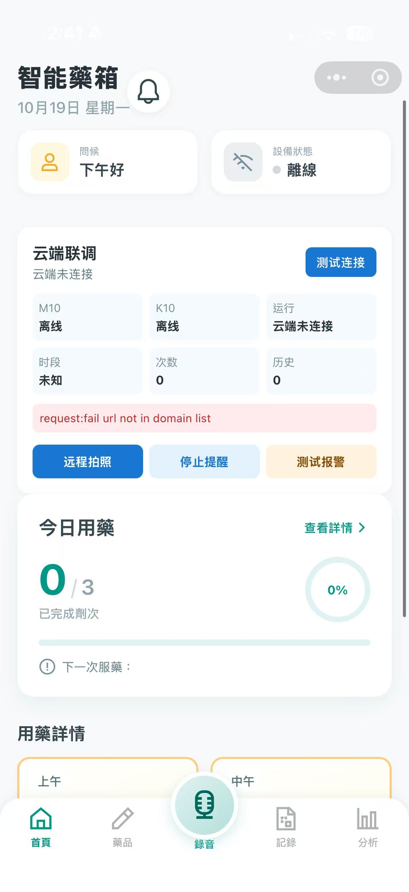
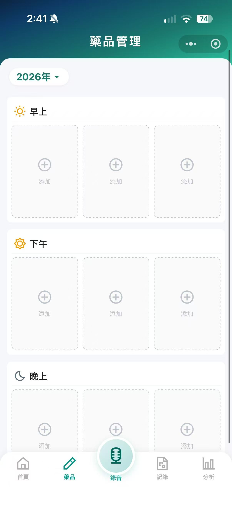
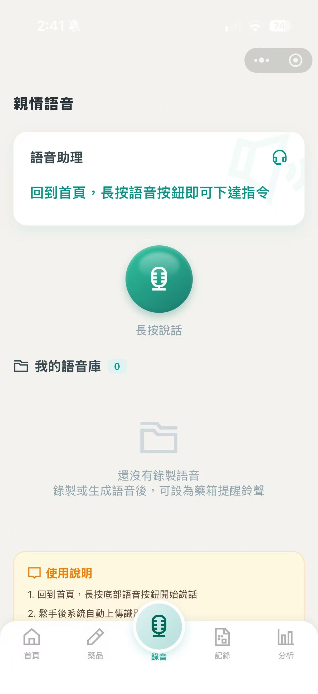
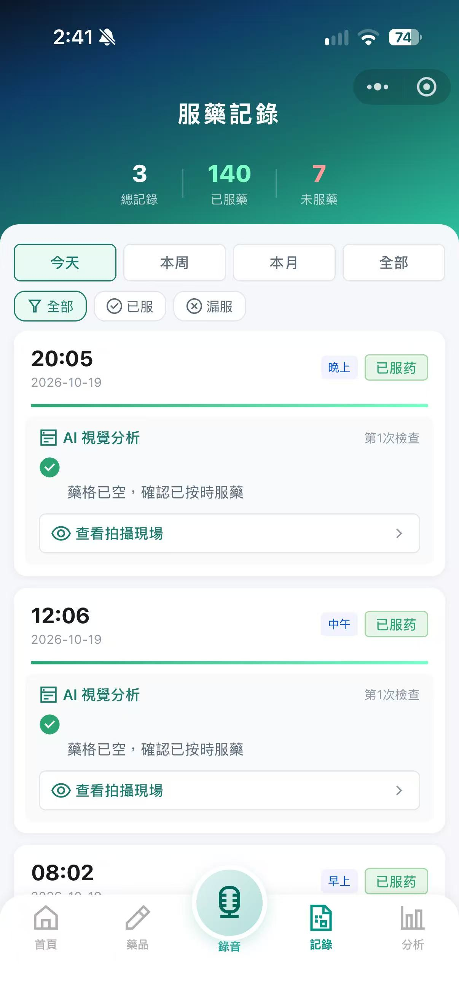
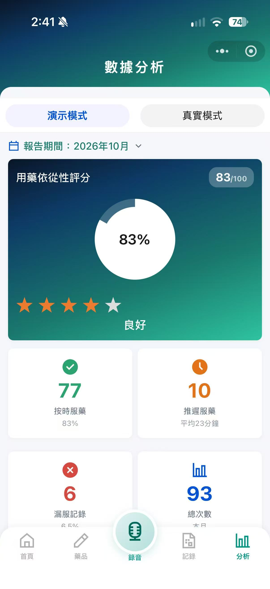

# 智能药箱 SmartMedBox · 微信小程序版

一个用于管理用药时间、查看用药记录和进行语音交互的微信小程序。通过首页、药品管理、录音、历史记录和数据分析等页面，将常用操作集中在手机端，方便查看和调整用药安排。

## 主要功能

- 用药管理：设置早、中、晚的提醒时间，查看当前用药状态。
- 语音交互：录音上传，通过后端接口进行语音处理和问答。
- 记录与分析：查看历史记录，以图表展示用药情况。
- 通知页面：集中展示提醒信息。

## 界面展示

<table>
<tr><th>首页</th><th>药品管理</th><th>亲情语音</th></tr>
<tr><td></td><td></td><td></td></tr>
<tr><th>服药记录</th><th>数据分析</th><th></th></tr>
<tr><td></td><td></td><td></td></tr>
</table>

首页展示未连接服务时的界面；服药记录与统计包含演示数据，用于展示页面布局和交互。

## 整体流程

1. 在小程序中录入或修改用药安排。
2. 请求模块将配置发送到后端，并获取状态与记录。
3. 后端处理配置、语音及状态相关请求，与 M10/K10 板端程序配合运行。
4. 小程序将返回的数据整理为状态卡片、历史列表和统计图表。

## 设计思路

先围绕“设置提醒—查看状态—回看记录”组织页面，再加入语音入口，减少在多个页面之间查找功能的步骤。网络请求集中在公共模块中，页面负责交互和显示，便于分别调整界面与接口。

这是智能药箱的前期版本，重点是小程序设计、交互和板端运行，当时尚未制作实体药箱。后续的实体制作与软硬件整合见 [IoT 版](https://github.com/Thomascheong2009115/smartmedbox-iot)。

## 目录结构

- `miniprogram/`：小程序页面、公共请求模块和配置。
- `miniprogram/sub_lib/components/ec-canvas/`：ECharts 图表及微信画布适配组件，保留原许可声明。
- `supporting-python/`：配套的后端与板端程序。
- `tests/`：请求处理及服务配置测试。

## 运行方式

1. 使用微信开发者工具导入 `miniprogram/`，填入自己的 AppID。
2. 在该目录执行 `npm ci`，在开发者工具中构建 npm。
3. 设置 `utils/config.js` 中的 `BASE_URL` 和 `app.js` 中的 `globalData.serverUrl`。真机联网需配置合法域名和 HTTPS。
4. 后端的密钥与服务地址通过进程环境变量设置，具体字段见 `.env.example`；程序不会自动读取 `.env`。

项目保留了演示数据和接口失败时的回退逻辑。未连接后端时，部分页面仍会显示演示内容，保存操作也可能返回演示成功状态；确认实际保存结果时需检查后端响应与数据。板端程序需要对应硬件和运行环境。

开发过程中使用了 AI 辅助生成代码，并进行调试与整合。
